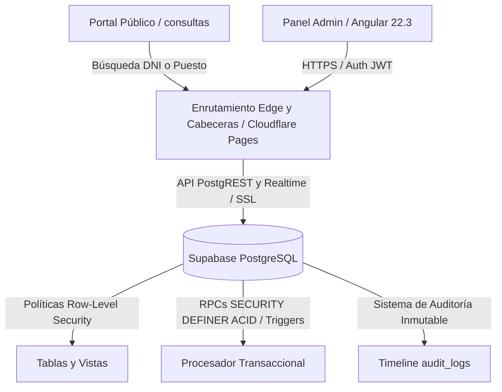

# Sistema Cooperativa Primero de Mayo

🌎 [English](README.md) · **Español**

Un sistema ERP y gestión financiera diseñado para mercados municipales y asociaciones cooperativas para la administración de locales comerciales, distribución de servicios básicos, cuentas corrientes de socios e inquilinos, control de cajas diarias y conciliación contable.


[](https://angular.dev)
[](https://supabase.com)
[](https://tailwindcss.com)

Plataforma de gestión especializada desarrollada para la **Cooperativa del Mercado Primero de Mayo** (`https://sistema.mercadoprimerodemayo.com`). Brinda a las juntas administrativas y cajeros una herramienta con transacciones ACID para administrar puestos y almacenes, prorratear consumos de agua y luz, facturar cuotas fijas de socios, registrar cobranzas en efectivo, transferencia y prepago por tarjeta, emitir recibos A4/80mm, conciliar ingresos contables y mantener una bitácora de auditoría narrativa inmutable.

---

## 🏗️ Vista General de la Arquitectura



---

## 🛠️ Stack Tecnológico

*   **Núcleo Frontend**: Angular `22.3.0` (Componentes Standalone, estado reactivo con **Signals**, detección de cambios explícita `ChangeDetectionStrategy.Eager`, `Zone.js`, compilador `@angular/build:application` con carga diferida por ruta) y **TypeScript `6.0.3`** (`strict: true`).
*   **Diseño y Estilos**: Tailwind CSS v4 (PostCSS, paleta armónica, tipografía Outfit, modo oscuro y diseño basado en TailAdmin).
*   **Base de Datos y Backend-as-a-Service**: **Supabase PostgreSQL** (API PostgREST protegida con JWT y políticas RLS, procedimientos almacenados `SECURITY DEFINER` con garantías ACID, triggers y canales de **Supabase Realtime** en `bancos`, `gastos` y `pagos`).
*   **Librerías Clave**:
    *   `@supabase/supabase-js` – Autenticación, ejecución de RPCs, consultas PostgREST y suscripciones Realtime.
    *   `apexcharts` & `ng-apexcharts` – Gráficos interactivos activos en Dashboard y Central de Reportes (incluyendo captura de gráficos para reportes PDF A4).
    *   `pdfmake` – Generación en navegador de recibos A4 y tickets térmicos 80mm (calibrados para Epson TM-T20IV-L), arqueos de caja, movimientos bancarios, padrones electorales e informes ejecutivos.
    *   `xlsx` (SheetJS) – Exportación de libros Excel multi-hoja cargada exclusivamente mediante `import()` dinámico (`ExcelExportService`, `ReportesExcelService` y `ReporteContableExcelService`).
    *   `flatpickr` – Selector ergonómico de fechas y períodos.
*   **Pruebas Automatizadas**: **Karma** (`~6.4.0`) + **Jasmine** (`~5.6.0`) con `15` pruebas unitarias y de validación funcional.
*   **Hosting y Seguridad**: **Cloudflare Pages** (Build System v3, `NODE_VERSION=22.23.4`, cabeceras HTTP configuradas en [public/_headers](public/_headers)).

---

## 🚀 Características Clave

*   **Directorio de Doble Perspectiva y Espacios:** Administra ocupaciones jerárquicas diferenciando espacios comerciales principales (puestos *Regular* / *Pequeño*) y unidades secundarias (*Almacenes*) asignados a Socios, Inquilinos o Terceros, junto con catálogo de *Giros* e historial inmutable de titularidad y arriendos.
*   **Facturación de Servicios y Cuotas:** Cálculo mensual de Agua y Luz según lecturas de medidores o prorrateo, alquiler de almacenes, cuotas fijas de socios (Gastos Administrativos y Previsión Social con suspensión individual) y cargos extraordinarios segmentados.
*   **Caja, Cobros Mixtos y Saldos a Favor:**
    *   Wizard de cobro en 3 pasos (`PagoWizardComponent`) con soporte para **Efectivo**, **Transferencia**, pagos mixtos y cancelación al 100 % con **Saldo a Favor** (`S/ 0.00` de efectivo ingresado) mediante `rpc_procesar_pago`, diferenciando claramente el dinero nuevo de caja/banco del saldo reutilizado.
    *   Emisión dual de comprobantes: formato **A4** y **tickets térmicos 80mm** calibrados para impresión a escala 100 % (`/configuracion/recibos`).
    *   **Recaudación por Tarjeta y Gestión:** Prepago semanal (`/recaudacion`) y módulo auditado de edición/anulación (`/cuenta-corriente/gestion-tarjeta`) con control de concurrencia y protección contra reversión de saldo ya consumido.
    *   **Caja Rápida e Ingresos Internos:** Registro diario sin recibo formal (`/pagos/ingresos-internos`) con gestión administrativa, edición y anulación auditada (`/cuenta-corriente/gestion-ingresos`).
*   **Fuente Única de la Deuda:** La función SQL canónica `fn_deudas_pagador` (complementada con la optimización set-based `00099` para listados masivos) alimenta Caja, Cuenta Corriente, Padrón, Asambleas y Portal Público.
*   **Arqueo de Caja Diario (`/reportes/arqueo-diario`):** Organiza los ingresos válidos en 3 bloques (**Socios**, **Inquilinos**, **Otros Ingresos**), excluye anulados de tablas y totales, separa el efectivo físico en gaveta (`Apertura + Efectivo − Gastos − Faltantes + Sobrantes`) de las transferencias/QR bancarias y genera un reporte PDF en 2 niveles.
*   **Central de Reportes Modernizada y Reporte Contable:**
    *   **Central de Reportes** (`/reportes`): Agregación server-side, comparativas entre períodos, gráficos ApexCharts, Excel de 4 hojas y PDF institucional A4 con distinción devengado vs flujo de caja.
    *   **Reporte Contable** (`/reportes/contable`): Conciliación detallada por comprobante contra la Central de Reportes, clasificación de documentos de identidad (`REGISTRADO`, `SIN REGISTRAR`, `POR VALIDAR`, `NO APLICA`), exportación anonimizada de muestra y **libro Excel de 9 hojas** (`00_RESUMEN` a `08_DOCUMENTOS_PENDIENTES`; la exportación con DNI completo requiere rol `Administrador` o `Caja`).
    *   **Estados de Cuenta y Asambleas:** Resumen consolidado de deudas (`/reportes/estados-cuenta`) y Padrón Electoral (`/asambleas`) con exportación a Excel y PDF.
*   **Portal Público Enmascarado (`/consultas`):** Acceso sin autenticación para consultar deudas pendientes, revisar historial de pagos y reimprimir recibos en PDF por DNI, nombre o puesto mediante RPCs `SECURITY DEFINER` (`rpc_public_buscar_pagador`, `rpc_public_cargar_deudas`, `rpc_public_obtener_historial`) con enmascaramiento de PII.
*   **Auditoría Narrativa (`/auditoria`):** Bitácora inmutable de solo-Administrador vía `rpc_auditoria_timeline` sobre `audit_logs`, mostrando actor, rol, diferencias "Antes ➔ Ahora" y motivos transaccionales.
*   **Bancos, Inventario y Beneficios:** Movimientos bancarios con actualización atómica de saldo y reporte PDF (`/bancos`, `/reportes/movimientos-bancarios`), Kardex con alertas de stock mínimo (`/inventario`) y registro/reporte de Dietas y Provisión Social (`/reportes/dietas`, `/reportes/provision-social`).

---

## ⚙️ Primeros Pasos

### Prerrequisitos
*   **Node.js `22.x`** (`22.23.4` configurado para los builds en Cloudflare Pages).
*   npm y Angular CLI (`@angular/cli` `22.x`).

### 1. Clonar el Repositorio
```bash
git clone https://github.com/omparedes/SistemaCooperativa.git
cd SistemaCooperativa
```

### 2. Configurar Credenciales de Supabase (`environment.ts` vs `.env`)
Es fundamental distinguir cómo se configura el frontend respecto a los scripts locales:

1. **Frontend Angular (`src/environments/environment.ts` y `environment.development.ts`):**
   * [supabase.client.ts](src/app/core/services/supabase.client.ts) consume `environment.supabaseUrl` y `environment.supabaseAnonKey` en tiempo de compilación; **la aplicación Angular NO lee el archivo `.env`**.
   * `supabaseAnonKey` es la clave pública de cliente (`anon` / *publishable*). El control de acceso real reside en PostgreSQL mediante políticas **RLS** y validaciones de rol en RPCs `SECURITY DEFINER` (`get_my_rol()`).
   * **NUNCA incluyas `SUPABASE_SERVICE_ROLE_KEY`, contraseñas de BD ni tokens administrativos en `src/environments/` ni en código frontend.**
2. **Scripts Locales / CLI (`.env`, ignorado por Git):**
   * Utilizado únicamente por herramientas CLI o scripts administrativos ejecutados en máquina local:
   ```ini
   SUPABASE_URL=https://tu-proyecto.supabase.co
   SUPABASE_SERVICE_ROLE_KEY=tu-clave-service-role-solo-scripts-locales
   SUPABASE_PROJECT_REF=tu-project-ref
   SUPABASE_DB_PASSWORD=tu-password-bd
   ```

### 3. Instalar Dependencias
```bash
npm install
```

### 4. Comandos de Desarrollo, Compilación y Pruebas
```bash
npm start          # Servidor local en http://localhost:4200
npm run build      # Build de producción -> dist/ng-tailadmin/browser
npm test           # Suite unitaria en Karma + Jasmine (15 pruebas)
```

---

## ☁️ Despliegue y Seguridad (Cloudflare Pages)

*   **Hosting:** Cloudflare Pages conectado a la rama `main` (`https://sistema.mercadoprimerodemayo.com`).
*   **Configuración de Build:** Build System **Version 3**, variable `NODE_VERSION=22.23.4` (en entornos Preview y Production), comando `npm run build` y directorio de salida `dist/ng-tailadmin/browser`.
*   **Cabeceras HTTP de Seguridad** ([public/_headers](public/_headers)):
    *   `X-Frame-Options: DENY`
    *   `Content-Security-Policy: frame-ancestors 'none'`
    *   `Permissions-Policy: camera=(), microphone=(), geolocation=()`
*   **Endurecimiento y Accesibilidad:**
    *   Se retiró la ruta pública de autorregistro (`/signup`); el alta y gestión de usuarios corresponde exclusivamente a `Administrador`.
    *   Mejoras implementadas en HTML/UI: `<html lang="es">`, contenedor principal semántico `<main>` en el layout y atributos `aria-label` / `aria-pressed` / `aria-hidden` en controles de visibilidad de contraseña.

---

## 📋 Variables de Entorno y Configuración

| Nombre | Ubicación | Propósito | Requerida | Alcance / Seguridad |
| :--- | :--- | :--- | :---: | :--- |
| `environment.supabaseUrl` | `src/environments/environment*.ts` | Endpoint REST/Auth/Realtime de Supabase para Angular | **Sí** | Cliente (Público) |
| `environment.supabaseAnonKey` | `src/environments/environment*.ts` | Clave pública de cliente controlada estrictamente por RLS | **Sí** | Cliente (Público bajo RLS) |
| `SUPABASE_SERVICE_ROLE_KEY` | `.env` (solo scripts locales) | Clave administrativa que omite RLS para scripts offline/migraciones | Solo scripts | **Secreto local/servidor — NUNCA en frontend** |
| `SUPABASE_PROJECT_REF` | `.env` / CLI | ID del proyecto remoto para Supabase CLI | No | Desarrollo / CLI |
| `SUPABASE_DB_PASSWORD` | `.env` / CLI | Contraseña de base de datos para conexiones CLI | No | Desarrollo / CLI |
| `NODE_VERSION` | Panel de Cloudflare Pages | Fijada en `22.23.4` en Preview y Production | **Sí** (CI) | Entorno de compilación |

---

## 📂 Estructura del Proyecto

```bash
SistemaCooperativa/
├── public/
│   ├── _headers                   # Cabeceras HTTP de seguridad en Cloudflare Pages
│   └── images/                    # Logotipos (incluido logo monocromo para ticket 80mm)
├── src/
│   ├── environments/              # Configuración Angular (supabaseUrl, supabaseAnonKey)
│   ├── app/
│   │   ├── core/
│   │   │   ├── config/            # version.config.ts (APP_VERSION_DATA)
│   │   │   ├── guards/            # authGuard, adminGuard, noAuthGuard
│   │   │   └── services/          # Servicios API, PDF, Excel, Reportes, Contable, Auditoría y Auth
│   │   ├── pages/                 # Módulos standalone con carga diferida (lazy loading)
│   │   │   ├── dashboard/         # Métricas ejecutivas y gráficos ApexCharts
│   │   │   ├── asambleas/         # Padrón electoral de asambleas
│   │   │   ├── socios/            # Socios, inquilinos, detalles y formularios
│   │   │   ├── espacios/          # Puestos, almacenes, ocupaciones y transferencias
│   │   │   ├── giros/             # Catálogo de giros comerciales
│   │   │   ├── pagos/             # Wizard de cobros y Caja Rápida
│   │   │   ├── recaudacion/       # Recaudación semanal por tarjeta
│   │   │   ├── cuenta-corriente/  # Cuentas corrientes, Gestión de Ingresos y Gestión de Tarjeta
│   │   │   ├── facturacion/       # Luz, Agua, Cargos Fijos y Extraordinarios
│   │   │   ├── reportes/          # Central, Arqueo, Reporte Contable, Bancos, Dietas y Estados de Cuenta
│   │   │   ├── gastos/ · bancos/ · inventario/
│   │   │   ├── auditoria/         # Timeline narrativo de auditoría (solo Admin)
│   │   │   ├── config/            # Tarifas y diseño de recibos
│   │   │   ├── usuarios/          # Administración de usuarios y roles (solo Admin)
│   │   │   ├── documentation/     # Manual de Usuario, Documentación Técnica y Novedades
│   │   │   └── consultas/         # Portal público sin autenticación
│   │   ├── shared/                # AppLayout, AppSidebar, AppHeader, Auth y componentes UI
│   │   ├── app.config.ts          # Zone change detection y recuperación ante ChunkLoadError
│   │   └── app.routes.ts          # Registro central de rutas lazy
│   └── styles.css                 # Punto de entrada Tailwind CSS v4
├── supabase/
│   ├── migrations/                # Migraciones SQL de esquema, RLS y RPCs (hasta 00100)
│   └── rollback/                  # Scripts de reversión (ej. 00099)
├── docs/plans/                    # Planes técnicos históricos de implementación
├── ARCHITECTURE.md                # Decisiones arquitectónicas (ADRs)
├── AUDITORIA_2026.md              # Auditoría funcional (corte julio 2026)
├── CHANGELOG.md                   # Historial técnico y de versiones
├── CLAUDE.md · CONTEXT.md         # Guías de trabajo y reglas de negocio del ERP
├── TODO.md                        # Backlog activo priorizado
└── package.json                   # Dependencias, scripts Angular CLI y Karma/Jasmine
```

---

## 🚧 Roadmap y Limitaciones Conocidas

El backlog priorizado se mantiene en [TODO.md](TODO.md) (junto con [ARCHITECTURE.md](ARCHITECTURE.md)):

*   **Integración Beneficios ↔ Caja:** Las dietas y ayudas de provisión social (`beneficios_socios`) cuentan con edición, baja lógica y auditoría (`00098`), pero aún no impactan el arqueo físico de caja ni los egresos operativos.
*   **Pendientes de Endurecimiento:** Regla "último administrador" (`rpc_gestionar_usuario`), RPC con motivo obligatorio para editar montos de cargos en Cuenta Corriente, triggers de auditoría en `perfiles` / `configuraciones` / `configuracion_recibos` / `caja_aperturas`, y recálculo automático de `socios.habilitado`.
*   **Definición del Rol `Asistente`:** Su alcance en la app sigue restringido en varios RPCs y bloquea explícitamente la exportación con DNI en Reporte Contable.
*   **Almacenamiento de PDFs y Búfer Offline:** Los PDFs se generan en el cliente con `pdfmake`; el archivado en Supabase Storage, envío por correo y soporte offline con IndexedDB siguen pendientes.
*   **Conciliación Bancaria Automatizada:** El registro de movimientos bancarios continúa siendo manual sin importación directa de extractos.

> *Nota sobre concurrencia en SQL:* El bloqueo de filas `FOR UPDATE` y la validación pagador↔deuda en `rpc_procesar_pago` / `anular_pago` (`00097`), junto con el control de concurrencia optimista/pesimista en `gestion-ingresos` (`00096`) y `gestion-tarjeta` (`00100`), ya están implementados en código y en `supabase/migrations/`. La ejecución efectiva de cada script SQL en una base remota debe confirmarse en el historial de migraciones de Supabase correspondiente.

---

## 📄 Licencia

Este proyecto es privado y propietario. Todos los derechos reservados. Desarrollado por **[Oscar Paredes](https://github.com/omparedes)**.

*   **LinkedIn**: [linkedin.com/in/omparedes](https://linkedin.com/in/omparedes)
*   **GitHub**: [@omparedes](https://github.com/omparedes)
