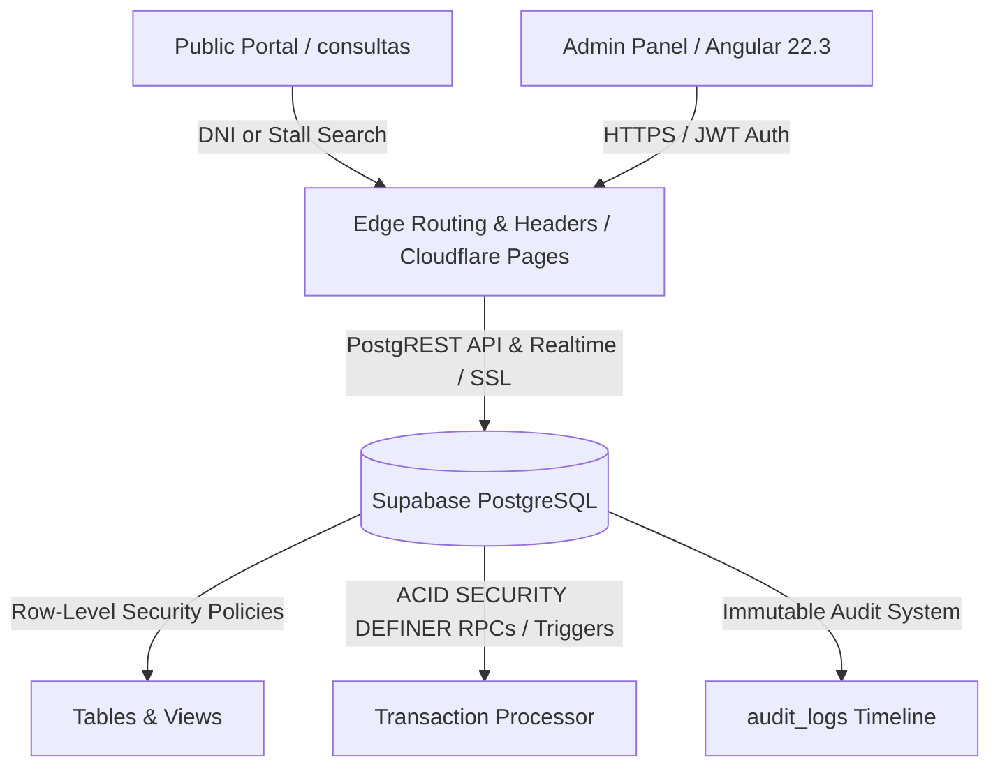

# Sistema Cooperativa Primero de Mayo

🌎 **English** · [Español](README.es.md)

An enterprise-grade ERP and financial management system built for municipal markets and cooperative associations to manage commercial stalls, utility distribution, member account statements, treasury cash desks, and accounting reconciliation.


[](https://angular.dev)
[](https://supabase.com)
[](https://tailwindcss.com)

A specialized management platform designed for the **Cooperativa del Mercado Primero de Mayo** (`https://sistema.mercadoprimerodemayo.com`). It provides administrative boards and cashiers with an ACID-compliant tool to manage stalls and warehouses, distribute water and electricity charges, bill fixed membership fees, process cash, bank transfers, and credit-card prepayments, reconcile accounting periods, and maintain an immutable narrative audit trail.

---

## 🏗️ Architecture & Flow Overview



---

## 🛠️ Tech Stack

*   **Frontend Core**: Angular `22.3.0` (Standalone Components, Reactive **Signals**, explicit `ChangeDetectionStrategy.Eager`, `Zone.js`, `@angular/build:application` with route-level lazy loading) and **TypeScript `6.0.3`** (`strict: true`).
*   **Styling & Design System**: Tailwind CSS v4 (PostCSS, harmonic palettes, Outfit typography, dark mode support, TailAdmin-based layout).
*   **Database & Backend-as-a-Service**: **Supabase PostgreSQL** (PostgREST API protected by JWT & Row-Level Security policies, ACID `SECURITY DEFINER` RPC stored procedures, triggers, and **Supabase Realtime** channels in `bancos`, `gastos`, and `pagos`).
*   **Key Libraries**:
    *   `@supabase/supabase-js` – Authentication, RPC execution, PostgREST queries, and Realtime subscriptions.
    *   `apexcharts` & `ng-apexcharts` – Active interactive charts in Dashboard and Central de Reportes (including chart snapshot embedding in institutional A4 PDF exports).
    *   `pdfmake` – Client-side PDF generation for A4 and 80mm thermal receipts (Epson TM-T20IV-L scale), daily cash closeouts, bank reports, electoral rolls, and institutional management reports.
    *   `xlsx` (SheetJS) – Multi-sheet Excel exports loaded strictly via lazy dynamic `import()` (`ExcelExportService`, `ReportesExcelService`, `ReporteContableExcelService`).
    *   `flatpickr` – Date and period selection.
*   **Testing**: **Karma** (`~6.4.0`) + **Jasmine** (`~5.6.0`) with `15` automated unit/integration specs.
*   **Hosting & Security**: **Cloudflare Pages** (Build System v3, `NODE_VERSION=22.23.4`, security HTTP headers configured in `public/_headers`).

---

## 🚀 Key Features

*   **Dual-Perspective Directory & Spaces**: Hierarchical management distinguishing primary retail Spaces (*Regular* / *Pequeño* stalls) and secondary storage Units (*Almacenes*) assigned to Partners (*Socios*), Tenants (*Inquilinos*), or Third-parties (*Terceros*), plus commercial categories (*Giros*) and immutable occupancy history.
*   **Granular Utility & Fixed Billing**: Monthly Water and Electricity calculation from meter readings or flat-rate sharing, warehouse leases, fixed member fees (GA & PS with individual suspension toggles), and segmented extraordinary charges.
*   **Cash Desk POS, Prepayments & Credit Balances**:
    *   3-step Payment Wizard (`PagoWizardComponent`) supporting Cash (`Efectivo`), Bank Transfers (`Transferencia`), mixed payments, and 100% **Saldo a Favor** (`S/ 0.00` cash) applications via `rpc_procesar_pago`, clearly separating new cash/bank inflows from reused credit balances.
    *   Dual receipt printing: **A4** institutional format and **80mm thermal tickets** calibrated for Epson TM-T20IV-L (`recibos-config`).
    *   **Card Prepayment & Management**: Weekly prepayment collections (`/recaudacion`) plus audited editing/annulment (`/cuenta-corriente/gestion-tarjeta`) with optimistic/pessimistic locking and automatic `saldo_a_favor` validation.
    *   **Quick Cash / Internal Income**: Spontaneous non-receipt collections (`/pagos/ingresos-internos`) with full admin audit & edit/annulment controls (`/cuenta-corriente/gestion-ingresos`).
*   **Single Source of Debt Truth**: Canonical SQL function `fn_deudas_pagador` (plus set-based batch summaries in `00099`) feeds Cash Desk, Account Statements, Directory, Electoral Roll, and the Public Portal.
*   **Daily Cash Reconciliation (*Arqueo de Caja*)**: Organizes daily inflows into 3 clear blocks (**Socios**, **Inquilinos**, **Otros Ingresos**), separates physical cash drawer (`Apertura + Efectivo − Gastos − Faltantes + Sobrantes`) from bank transfers/QR, excludes annulled receipts from totals and tables, and generates a 2-level A4 PDF report.
*   **Modernized Reporting Hub & Accounting Report**:
    *   **Central de Reportes** (`/reportes`): Server-aggregated KPIs, period comparisons, ApexCharts visualizations, 4-sheet Excel exports, institutional A4 PDFs, and accrual vs. cash-flow notes.
    *   **Reporte Contable** (`/reportes/contable`): Receipt-level audit, reconciliation against Central de Reportes, DNI/RUC validation (`REGISTRADO`, `SIN REGISTRAR`, `POR VALIDAR`, `NO APLICA`), anonymized review mode, and **9-sheet Excel export** (`00_RESUMEN` through `08_DOCUMENTOS_PENDIENTES`, restricted to `Administrador` and `Caja` for full DNI export).
    *   **Account Statements & Assemblies**: Consolidated debt statements (`/reportes/estados-cuenta`) and Electoral Roll (`/asambleas`) with eligible/delinquent tracking and Excel/PDF exports.
*   **Masked Public Portal (`/consultas`)**: Unauthenticated portal where members query pending debts, review payment history, and reprint PDF receipts by DNI, name, or stall code, backed by `SECURITY DEFINER` RPCs (`rpc_public_buscar_pagador`, `rpc_public_cargar_deudas`, `rpc_public_obtener_historial`) with PII masking.
*   **Narrative Audit Timeline (`/auditoria`)**: Admin-only immutable activity timeline reading `audit_logs` via `rpc_auditoria_timeline` with field-level diffs and transactional reasons.
*   **Banks, Inventory & Member Benefits**: Atomic bank balance tracking and PDF movement reports (`/bancos`, `/reportes/movimientos-bancarios`), internal warehouse Kardex with low-stock alerts (`/inventario`), and Diets / Social Provision records (`/reportes/dietas`, `/reportes/provision-social`).

---

## ⚙️ Getting Started

### Prerequisites
*   **Node.js `22.x`** (`22.23.4` is configured for Cloudflare Pages builds).
*   npm and Angular CLI (`@angular/cli` `22.x`).

### 1. Clone the Repository
```bash
git clone https://github.com/omparedes/SistemaCooperativa.git
cd SistemaCooperativa
```

### 2. Configure Supabase Credentials (`environment.ts` vs `.env`)
Important distinction between the Angular browser application and administrative Node/CLI scripts:

1. **Frontend Angular (`src/environments/environment.ts` & `environment.development.ts`):**
   * [supabase.client.ts](src/app/core/services/supabase.client.ts) reads `environment.supabaseUrl` and `environment.supabaseAnonKey` at build time—**the Angular app does NOT read `.env`**.
   * `supabaseAnonKey` is the **public client key (anon / publishable)**. Security is enforced in PostgreSQL via **Row-Level Security (RLS)** policies and `SECURITY DEFINER` RPC role checks (`get_my_rol()`).
   * **NEVER place `SUPABASE_SERVICE_ROLE_KEY`, database passwords, or management tokens in `src/environments/` or any frontend code.**
2. **Local Admin / Migration Scripts (`.env`, gitignored):**
   * Used exclusively by CLI tooling and local database scripts:
   ```ini
   SUPABASE_URL=https://your-project.supabase.co
   SUPABASE_SERVICE_ROLE_KEY=your-service-role-key-server-scripts-only
   SUPABASE_PROJECT_REF=your-project-ref
   SUPABASE_DB_PASSWORD=your-db-password
   ```

### 3. Install Dependencies
```bash
npm install
```

### 4. Local Commands (Run, Build & Test)
```bash
npm start          # Dev server at http://localhost:4200
npm run build      # Production bundle -> dist/ng-tailadmin/browser
npm test           # Karma + Jasmine unit test suite (15 specs)
```

---

## ☁️ Deployment & Security (Cloudflare Pages)

*   **Hosting**: Cloudflare Pages connected to `main` (`https://sistema.mercadoprimerodemayo.com`).
*   **Build Configuration**: Build System **Version 3**, `NODE_VERSION=22.23.4` (configured in Preview and Production), build command `npm run build`, output directory `dist/ng-tailadmin/browser`.
*   **HTTP Security Headers** ([public/_headers](public/_headers)):
    *   `X-Frame-Options: DENY`
    *   `Content-Security-Policy: frame-ancestors 'none'`
    *   `Permissions-Policy: camera=(), microphone=(), geolocation=()`
*   **Access & Hardening**:
    *   Public self-registration (`/signup`) was removed from active routes; user provisioning is restricted to `Administrador` accounts.
    *   Accessibility and semantic improvements implemented: `<html lang="es">`, `<main>` landmark in layout, and `aria-label` / `aria-pressed` / `aria-hidden` attributes on authentication password toggles.

---

## 📋 Configuration & Environment Reference

| Name | Where Used | Purpose | Required | Security Scope |
| :--- | :--- | :--- | :---: | :--- |
| `environment.supabaseUrl` | `src/environments/environment*.ts` | Supabase REST/Auth/Realtime endpoint for Angular | **Yes** | Client (Public) |
| `environment.supabaseAnonKey` | `src/environments/environment*.ts` | Client anon/publishable key strictly governed by RLS | **Yes** | Client (Public, RLS-protected) |
| `SUPABASE_SERVICE_ROLE_KEY` | `.env` (local scripts only) | Administrative key bypassing RLS for offline scripts/migrations | Scripts only | **Server / Local Secret — NEVER expose in frontend** |
| `SUPABASE_PROJECT_REF` | `.env` / CLI | Remote project reference ID for Supabase CLI | No | Development / CLI |
| `SUPABASE_DB_PASSWORD` | `.env` / CLI | Database password for CLI/migration connections | No | Development / CLI |
| `NODE_VERSION` | Cloudflare Pages settings | Pinned to `22.23.4` in Preview and Production | **Yes** (CI) | CI / Build Environment |

---

## 📂 Project Structure

```bash
SistemaCooperativa/
├── public/
│   ├── _headers                   # Cloudflare Pages HTTP security headers
│   └── images/                    # Logos (including 80mm monochrome thermal logo)
├── src/
│   ├── environments/              # Angular build configs (supabaseUrl, supabaseAnonKey)
│   ├── app/
│   │   ├── core/
│   │   │   ├── config/            # version.config.ts (APP_VERSION_DATA)
│   │   │   ├── guards/            # authGuard, adminGuard, noAuthGuard
│   │   │   └── services/          # API, PDF, Excel, Reports, Accounting, Audit & Auth services
│   │   ├── pages/                 # Standalone lazy-loaded modules
│   │   │   ├── dashboard/         # Executive KPIs & ApexCharts overview
│   │   │   ├── asambleas/         # Electoral roll (Asambleas)
│   │   │   ├── socios/            # Partners & Tenants directory/details/forms
│   │   │   ├── espacios/          # Stalls, warehouses, occupancies & transfers
│   │   │   ├── giros/             # Commercial activity categories
│   │   │   ├── pagos/             # Payment POS wizard & Caja Rápida
│   │   │   ├── recaudacion/       # Weekly card prepayments
│   │   │   ├── cuenta-corriente/  # Account statements, Gestión de Ingresos & Gestión de Tarjeta
│   │   │   ├── facturacion/       # Utilities distribution, fixed fees & extraordinary charges
│   │   │   ├── reportes/          # Central, Arqueo, Reporte Contable, Bancos, Dietas, Estados de Cuenta
│   │   │   ├── gastos/ · bancos/ · inventario/
│   │   │   ├── auditoria/         # Narrative audit timeline (Admin-only)
│   │   │   ├── config/            # Tariffs & receipt designer
│   │   │   ├── usuarios/          # User & role administration (Admin-only)
│   │   │   ├── documentation/     # User Manual, Technical Docs & Release Notes
│   │   │   └── consultas/         # Public unauthenticated debt/history portal
│   │   ├── shared/                # AppLayout, AppSidebar, AppHeader, Auth & UI components
│   │   ├── app.config.ts          # Zone change detection & ChunkLoadError recovery handler
│   │   └── app.routes.ts          # Central lazy-loaded route registry
│   └── styles.css                 # Tailwind CSS v4 entrypoint
├── supabase/
│   ├── migrations/                # SQL schema, RLS & RPC migrations (up to 00100)
│   └── rollback/                  # Rollback scripts (e.g. 00099)
├── docs/plans/                    # Historical technical implementation plans
├── ARCHITECTURE.md                # Architecture Decision Records (ADRs)
├── AUDITORIA_2026.md              # Functional audit snapshot (July 2026 cut-off)
├── CHANGELOG.md                   # Technical & product changelog
├── CLAUDE.md · CONTEXT.md         # Engineering guidelines & business domain rules
├── TODO.md                        # Prioritized active backlog
└── package.json                   # Dependencies, Angular CLI & Karma/Jasmine scripts
```

---

## 🚧 Roadmap & Known Limitations

Active items remain tracked in [TODO.md](TODO.md) (complemented by [ARCHITECTURE.md](ARCHITECTURE.md)):

*   **Benefits ↔ Cash Desk Integration**: Diets and social-provision payouts (`beneficios_socios`) are audited and managed (`00098`), but are not yet wired as physical drawer expenses (`gastos`) or bank movements in daily cash closeouts.
*   **Remaining Hardening Items**: Prevent self-demotion / "last active Admin" (`rpc_gestionar_usuario`), direct RPC with mandatory reason for editing pending debt amounts in Cuenta Corriente, audit triggers on `perfiles` / `configuraciones` / `configuracion_recibos` / `caja_aperturas`, and automatic `habilitado` status recalculation.
*   **Clarify / Decide `Asistente` Role**: RLS allows read access, yet several financial RPCs require `Administrador` or `Caja`, and DNI export in Reporte Contable explicitly blocks `Asistente`.
*   **Cloud PDF Storage & Offline Buffer**: PDFs are generated client-side (`pdfmake`); cloud archiving in Supabase Storage and IndexedDB offline transaction buffering remain unimplemented.
*   **Automated Bank Statement Import**: Bank reconciliation relies on manual entry rather than automated bank file parsing.

> *Note on SQL concurrency & safeguards:* Pessimistic `FOR UPDATE` row locking and payer↔debt validation in `rpc_procesar_pago` and `anular_pago` (`00097`), plus optimistic concurrency in `gestion-ingresos` (`00096`) and `gestion-tarjeta` (`00100`), are implemented in code and `supabase/migrations/`. Deployment/execution status on each remote environment must always be verified via Supabase migration records rather than assumed from file presence.

---

## 📄 License

This project is private and proprietary. All rights reserved. Developed by **[Oscar Paredes](https://github.com/omparedes)**.

*   **LinkedIn**: [linkedin.com/in/omparedes](https://linkedin.com/in/omparedes)
*   **GitHub**: [@omparedes](https://github.com/omparedes)
