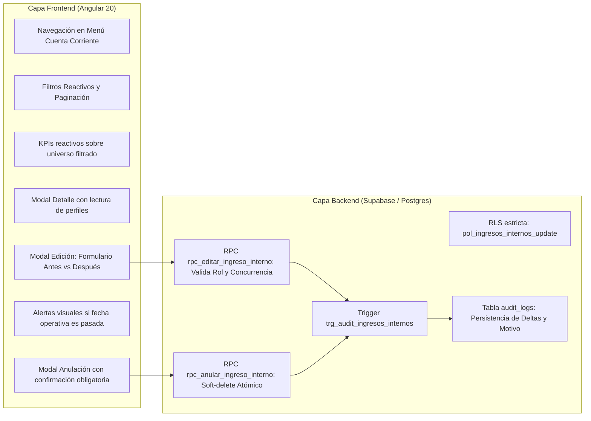

# PLAN DE IMPLEMENTACIÓN: MÓDULO GESTIÓN DE INGRESOS
**Sistema ERP — Mercado Cooperativo Primero de Mayo**
**Fecha:** 14 de Octubre de 2026  
**Documento:** `docs/plans/PLAN_GESTION_INGRESOS.md`  
**Estado:** Propuesta Técnica Ajustada (Fase 1: Auditoría y Planificación — Versión 2.0 con Seguridad y Auditoría Reforzada)

---

## 1. DIAGNÓSTICO Y ANÁLISIS DE SEGURIDAD

### 1.1. Estado actual del flujo "Caja Rápida"
- **Ruta frontend:** `/pagos/ingresos-internos` (`src/app/pages/pagos/ingresos-internos.component.ts`).
- **Servicio Angular:** `src/app/core/services/ingresos-internos.service.ts`.
- **Propósito:** Registro rápido y espontáneo de ingresos que no provienen de deudas de padrón (p. ej. SS.HH., Parqueo, Tickets, Alquileres temporales, Espacios, Depósitos, Donaciones).
- **Almacenamiento:** Tabla `public.ingresos_internos` en Supabase.
- **Función de inserción:** RPC `registrar_ingreso_interno(p_concepto_id, p_monto, p_metodo_pago, p_usuario_id, p_observacion)`.
- **Identificador de referencia:** Las transacciones se identifican internamente como `INT-XXXXXX` (p. ej., `INT-000056` para `id = 56`).
- **Estado de datos en producción:** 57 registros vigentes, 0 anulados.

### 1.2. Vulnerabilidades y carencias identificadas en la auditoría
1. **Brecha en RLS actual:**
   - La migración 00014 definió la política:
     ```sql
     create policy pol_ingresos_internos_update on public.ingresos_internos
         for update to authenticated using (true) with check (true);
     ```
   - **Riesgo:** Cualquier usuario autenticado que conozca el endpoint de Supabase podría ejecutar un `UPDATE` directo sobre la tabla `ingresos_internos`, eludiendo las restricciones de la interfaz.
2. **Carencia de Auditoría de Ediciones en `ingresos_internos`:**
   - A diferencia de las tablas `pagos`, `socios`, `inquilinos`, `puestos`, `gastos` y `caja_ajustes` (que cuentan con triggers hacia `public.audit_logs`), `ingresos_internos` **no tiene trigger de auditoría**.
   - Solo registra `updated_at`, lo cual es insuficiente porque no conserva el historial de: quién modificó, cuándo, qué campos cambiaron, los valores anteriores/nuevos ni el motivo.
3. **Ausencia de Control de Concurrencia:**
   - Si dos supervisores o cajeros abren simultáneamente el mismo ingreso, el último en guardar sobrescribe silenciosamente los cambios del anterior.
4. **Ausencia de interfaz administrativa:**
   - No existe pantalla para buscar, filtrar, auditar, editar o anular ingresos ya registrados.

---

## 2. SEGURIDAD Y CONTROL DE ACCESO (SERVER-SIDE Y CLIENT-SIDE)

Para asegurar que nadie pueda alterar información financiera sin autorización, la seguridad se implementa en dos capas:

### 2.1. Matriz de Permisos por Rol
El ERP maneja el enum `tipo_rol`: `'Administrador'`, `'Caja'`, `'Asistente'`.

| Operación | Administrador | Caja | Asistente | Mecanismo de Control |
|---|:---:|:---:|:---:|---|
| **Consultar / Buscar Ingresos** | SÍ | SÍ | SÍ | RLS SELECT `to authenticated` |
| **Registrar Ingreso (Caja Rápida)** | SÍ | SÍ | NO | RPC `registrar_ingreso_interno` |
| **Editar Ingreso de Hoy** | SÍ | SÍ (solo propio turno) | NO | RPC con validación de rol y usuario |
| **Editar Ingreso de Días Anteriores** | SÍ | **NO** | NO | RPC valida estrictamente `Administrador` |
| **Anular Ingreso (Cualquier fecha)** | SÍ | **NO** | NO | RPC valida estrictamente `Administrador` |

### 2.2. Ajuste Mínimo de RLS en Supabase
Se reemplaza la política permisiva por una política estricta en `public.ingresos_internos`:
```sql
-- Restringe UPDATE directo únicamente a usuarios con rol Administrador
drop policy if exists pol_ingresos_internos_update on public.ingresos_internos;
create policy pol_ingresos_internos_update on public.ingresos_internos
    for update to authenticated
    using  (public.get_my_rol() = 'Administrador')
    with check (public.get_my_rol() = 'Administrador');
```
*Beneficio:* Ningún usuario no-administrador puede modificar directamente la tabla desde la API REST/PostgREST. Las modificaciones ordinarias se canalizan obligatoriamente por la RPC de seguridad.

---

## 3. AUDITORÍA REAL Y TRAZABILIDAD DE EDICIONES

El sistema de auditoría existente en el ERP (`public.audit_logs` y `public.log_audit_action()`, refinado en la migración 00086) se reutiliza al 100%.

### 3.1. Trigger de Auditoría en `ingresos_internos`
Se conecta `public.ingresos_internos` al motor de auditoría central:
```sql
drop trigger if exists trg_audit_ingresos_internos on public.ingresos_internos;
create trigger trg_audit_ingresos_internos
    after insert or update or delete on public.ingresos_internos
    for each row execute function public.log_audit_action();
```

### 3.2. Qué registra `audit_logs` en cada edición y anulación:
- **Quién:** `changed_by` (UUID del usuario autenticado vía `auth.uid()`). Permite cruzar con `public.perfiles` para obtener nombre, apellido y rol.
- **Cuándo:** `created_at` (timestamp inmutable generado por el servidor Postgres).
- **Qué cambió (Deltas exactos):** `old_data` y `new_data` en formato `jsonb`. Al ejecutarse una edición de método de pago de *Efectivo* a *Transferencia*, el trigger guarda el snapshot completo anterior y posterior. Las consultas y la vista `/auditoria` calculan automáticamente los cambios campo a campo (`campo`, `antes`, `despues`).
- **Por qué (Justificación):** La RPC ejecuta `PERFORM set_config('app.audit_motivo', p_motivo, true)`. La función `log_audit_action()` lee esta variable de sesión transaccional y la inserta en la columna `audit_logs.motivo`.
- **Integración con la Línea de Tiempo (`/auditoria`):**
  Al registrarse en `audit_logs`, cualquier edición o anulación de un ingreso interno aparecerá automáticamente en la pantalla de Auditoría del ERP con su detalle narrativo completo.

---

## 4. MODIFICACIONES DE DÍAS ANTERIORES Y CIERRES DE CAJA

### 4.1. Diagnóstico del Estado de Cuadres de Caja
- El ERP cuenta con la tabla `public.caja_aperturas` (saldo inicial diario) y `public.caja_ajustes` (faltantes/sobrantes físicos de gaveta).
- No existe una tabla de bloqueo duro que congele físicamente las transacciones, pero el **Arqueo de Caja Diario** (`src/app/pages/reportes/arqueo-caja.component.ts`) es el documento contable de control que se imprime en PDF al terminar la jornada.
- **Diferencia técnica fundamental:**
  - `created_at`: Fecha y hora técnica real de inserción en el servidor. **Es inmutable**.
  - `fecha_ingreso`: Fecha operativa a la cual se imputa contablemente el ingreso.
  - `updated_at`: Fecha de última edición técnica (manejada automáticamente por trigger).

### 4.2. Reglas de Protección para Fechas Anteriores
1. **Detección de fecha pasada:** Se evalúa si `fecha_ingreso::date < (now() at time zone 'America/Lima')::date`.
2. **Restricción de Rol:** Si la fecha operativa es de un día anterior, **solo el Administrador** tiene autorización para modificar o anular el registro. La RPC arrojará una excepción inmediata si el usuario no tiene rol `Administrador`:
   `RAISE EXCEPTION 'Solo un Administrador puede modificar ingresos de fechas anteriores.';`
3. **Advertencia Visual Explícita (Frontend):**
   Si el registro a editar o anular corresponde a una fecha pasada, la interfaz muestra un banner de advertencia en color ámbar/rojo:
   > ⚠️ **Atención:** Este ingreso corresponde al arqueo del **dd/MM/yyyy**. Cualquier modificación o anulación alterará el saldo contable histórico ya cerrado de dicha fecha.
4. **Justificación reforzada:** Para fechas pasadas se exige un motivo detallado (mínimo 10 caracteres) para garantizar la trazabilidad ante revisiones de la directiva.

---

## 5. CONCURRENCIA, ATOMICIDAD Y CONSISTENCIA

### 5.1. Control de Concurrencia Optimista (OCC)
Para evitar que dos operadores sobrescriban cambios simultáneamente:
1. Al cargar la información en el formulario modal, el cliente retiene el timestamp `updated_at` original del registro.
2. Al invocar la RPC de edición, se envía el parámetro `p_updated_at`.
3. La RPC compara:
   ```sql
   if v_registro.updated_at <> p_updated_at then
       raise exception 'El registro fue modificado por otro usuario en este intervalo. Por favor recargue la página.';
   end if;
   ```
4. Si alguien modificó el registro milisegundos antes, la transacción se revierte de forma segura y se notifica al usuario sin pérdida de datos.

### 5.2. Atomicidad Transaccional
La edición/anulación y el registro de auditoría ocurren dentro de la misma transacción en Postgres. Si falla la validación o la escritura en `audit_logs`, la operación completa hace `ROLLBACK`.

### 5.3. Consistencia de los KPIs y Totales
Los componentes de resumen financiero superior:
- **Total Vigente**
- **Total Efectivo**
- **Total Transferencia / QR**
- **Cantidad de Operaciones**
Se calcularán sobre **el total del conjunto filtrado activo**, no únicamente sobre los registros visibles en la página actual del paginador (p. ej., si hay 57 registros y la página muestra 20, los KPIs sumarán los 57).

---

## 6. PROPUESTA TÉCNICA DEFINITIVA (RPCs Y BASE DE DATOS)

Se propone una **migración aditiva y no destructiva**:
`supabase/migrations/00096_gestion_ingresos_seguridad_auditoria.sql`

### 6.1. RPC: `rpc_editar_ingreso_interno`
```sql
create or replace function public.rpc_editar_ingreso_interno(
    p_id            bigint,
    p_fecha_ingreso timestamptz,
    p_monto         numeric,
    p_metodo_pago   text,
    p_concepto_id   bigint,
    p_observacion   text,
    p_motivo        text,
    p_updated_at    timestamptz
)
returns jsonb
language plpgsql
security definer
set search_path = public
as $$
declare
    v_actual record;
    v_rol    text;
    v_es_pasado boolean;
begin
    v_rol := public.get_my_rol();
    if v_rol not in ('Administrador', 'Caja') then
        raise exception 'Acceso denegado: permisos insuficientes.';
    end if;

    select * into v_actual from public.ingresos_internos where id = p_id;
    if not found then
        raise exception 'Ingreso % no encontrado.', p_id;
    end if;
    if v_actual.deleted_at is not null then
        raise exception 'El ingreso % se encuentra anulado y no puede editarse.', p_id;
    end if;

    -- Concurrencia optimista
    if p_updated_at is not null and v_actual.updated_at <> p_updated_at then
        raise exception 'El registro fue modificado por otro operador. Actualice la vista antes de continuar.';
    end if;

    -- Validación de fechas pasadas
    v_es_pasado := (v_actual.fecha_ingreso at time zone 'America/Lima')::date < (now() at time zone 'America/Lima')::date;
    if v_es_pasado and v_rol <> 'Administrador' then
        raise exception 'Solo un Administrador puede modificar ingresos de fechas anteriores.';
    end if;

    -- Validaciones de datos
    if p_monto is null or p_monto <= 0 then
        raise exception 'El monto debe ser mayor a cero.';
    end if;
    if p_metodo_pago not in ('Efectivo', 'Transferencia') then
        raise exception 'Método de pago inválido.';
    end if;
    if nullif(trim(p_motivo), '') is null then
        raise exception 'El motivo de la modificación es obligatorio.';
    end if;

    -- Configurar motivo para el trigger de auditoría
    perform set_config('app.audit_motivo', trim(p_motivo), true);

    -- Actualización de datos (created_at permanece intacto)
    update public.ingresos_internos
    set
        fecha_ingreso = coalesce(p_fecha_ingreso, fecha_ingreso),
        monto         = p_monto,
        metodo_pago   = p_metodo_pago,
        concepto_id   = p_concepto_id,
        observacion   = nullif(trim(p_observacion), ''),
        updated_at    = now()
    where id = p_id;

    return jsonb_build_object('ok', true, 'mensaje', 'Ingreso actualizado correctamente.');
end;
$$;
```

### 6.2. RPC: `rpc_anular_ingreso_interno`
```sql
create or replace function public.rpc_anular_ingreso_interno(
    p_id     bigint,
    p_motivo text
)
returns jsonb
language plpgsql
security definer
set search_path = public
as $$
declare
    v_actual record;
    v_rol    text;
begin
    v_rol := public.get_my_rol();
    if v_rol <> 'Administrador' then
        raise exception 'Acceso denegado: solo un Administrador puede anular ingresos.';
    end if;

    select * into v_actual from public.ingresos_internos where id = p_id;
    if not found then
        raise exception 'Ingreso % no encontrado.', p_id;
    end if;
    if v_actual.deleted_at is not null then
        raise exception 'El ingreso % ya está anulado.', p_id;
    end if;

    if nullif(trim(p_motivo), '') is null or length(trim(p_motivo)) < 5 then
        raise exception 'El motivo de anulación es obligatorio (mínimo 5 caracteres).';
    end if;

    -- Configurar motivo para el trigger de auditoría
    perform set_config('app.audit_motivo', trim(p_motivo), true);

    -- Soft-delete consistente con constraint chk_ingresos_internos_anulacion_consistente
    update public.ingresos_internos
    set
        deleted_at       = now(),
        anulado_por      = auth.uid(),
        motivo_anulacion = trim(p_motivo),
        updated_at       = now()
    where id = p_id;

    return jsonb_build_object('ok', true, 'mensaje', 'Ingreso anulado correctamente.');
end;
$$;
```

---

## 7. DISTRIBUCIÓN DE RESPONSABILIDADES: ANGULAR VS SUPABASE



### 7.1. Qué se resuelve exclusivamente en Angular
1. **Navegación e integración en el Sidebar:**
   - Menú *Cuenta Corriente* -> Opción *Gestión de Ingresos* (`/cuenta-corriente/gestion-ingresos`).
2. **Cálculo reactivo de KPIs:**
   - Totales de Efectivo, Transferencia, Vigente y Operaciones en tiempo real calculados sobre todos los registros filtrados.
3. **Manejo de estado reactivo mediante Signals:**
   - Selección de filtros, control de carga, paginación suave.
4. **Experiencia de usuario y prevención de errores:**
   - Formulario de edición con comparación visual previa (*Valor original* vs *Valor nuevo*).
   - Bloqueo de botones si no hay justificación ingresada.
   - Detección y alerta visual en pantalla si el usuario intenta modificar un ingreso de días anteriores.

### 7.2. Qué se resuelve en Supabase
1. **Protección perimetral (RLS):** Bloqueo de updates directos de usuarios no administradores.
2. **Validación de permisos rígida:** La RPC no permite a usuarios comunes modificar ingresos ni a cajeros modificar días anteriores.
3. **Control de concurrencia optimista:** Verificación de `updated_at`.
4. **Auditoría inmutable:** Inserción de deltas y motivos en `public.audit_logs`.

---

## 8. PLAN DE NO-REGRESIÓN Y PROTECCIÓN DE DATOS REALES

### 8.1. Protección de los 57 Registros Vigentes
- Los 57 registros reales en `public.ingresos_internos` **no serán alterados durante las fases de desarrollo ni pruebas**.
- Durante las pruebas unitarias y de integración:
  1. Se utilizarán consultas de solo lectura (`SELECT`).
  2. Para validar la edición, concurrencia y anulación en tiempo real, se insertará un **registro de prueba único y controlado** mediante la RPC existente:
     `INSERT INTO public.ingresos_internos (concepto_id, monto, metodo_pago, observacion) VALUES (18, 1.00, 'Efectivo', 'REGISTRO_PRUEBA_SISTEMA');`
  3. Sobre este registro de prueba se probará la edición, la anulación y la auditoría.
  4. Una vez verificadas las pruebas, dicho registro de prueba se eliminará limpiamente, dejando la base de datos exactamente con sus 57 registros originales intactos.

### 8.2. Módulos que Permanecen 100% Inalterados
- **Caja Rápida (`/pagos/ingresos-internos`):** Su flujo de cobro espontáneo no sufre ningún cambio.
- **Registro Regular de Pagos (`/pagos/registrar`):** Flujo de socios e inquilinos intacto.
- **Padrón de Socios e Inquilinos:** Totalmente inalterado.
- **Emisión de Recibos y Comprobantes:** Intacto.
- **Central de Reportes y Arqueo Diario:** Continúan consumiendo los datos de la forma habitual; al consultar `deleted_at IS NULL`, los cambios y anulaciones se reflejan armónicamente.

---

## 9. ARCHIVOS Y MIGRACIONES A CREAR / MODIFICAR

### 9.1. Archivos en Frontend (Angular)
1. `src/app/pages/cuenta-corriente/gestion-ingresos/gestion-ingresos.component.ts` *(Nuevo)*
2. `src/app/pages/cuenta-corriente/gestion-ingresos/ingreso-form-modal.component.ts` *(Nuevo)*
3. `src/app/pages/cuenta-corriente/gestion-ingresos/ingreso-anular-modal.component.ts` *(Nuevo)*
4. `src/app/pages/cuenta-corriente/gestion-ingresos/ingreso-detalle-modal.component.ts` *(Nuevo)*
5. `src/app/core/services/gestion-ingresos.service.ts` *(Nuevo)*
6. `src/app/app.routes.ts` *(Modificación: Registrar ruta)*
7. `src/app/shared/layout/app-sidebar/app-sidebar.component.ts` *(Modificación: Añadir opción en menú)*

### 9.2. Migración en Supabase
1. `supabase/migrations/00096_gestion_ingresos_seguridad_auditoria.sql` *(Nueva, limpia y aditiva)*:
   - Refinamiento de RLS `pol_ingresos_internos_update`.
   - Trigger `trg_audit_ingresos_internos` hacia `public.log_audit_action()`.
   - Creación de `rpc_editar_ingreso_interno` con OCC y validaciones.
   - Creación de `rpc_anular_ingreso_interno` con soft-delete consistente.
   - Grants a rol `authenticated`.

---

## 10. CRITERIOS DE ACEPTACIÓN DE LA IMPLEMENTACIÓN

1. **Seguridad verificada:** Un usuario con rol `Asistente` o `Caja` no puede forzar la anulación de ningún ingreso ni la edición de ingresos de días anteriores, ni por interfaz ni llamando a Supabase.
2. **Auditoría completa:** Cada modificación genera un registro en `audit_logs` con `changed_by`, `accion = 'UPDATE'`, los deltas exactos (`antes` vs `despues`) y el `motivo` justificado.
3. **Consistencia con Arqueo Diario:**
   - Modificar un ingreso de `Efectivo` a `Transferencia` actualiza los totales del arqueo en tiempo real.
   - Anular un ingreso lo descuenta inmediatamente del arqueo y reportes.
4. **Fechas protegidas:** Se mantiene intacta la fecha técnica `created_at`, mientras que la fecha contable `fecha_ingreso` refleja las correcciones autorizadas.
5. **Concurrencia:** Modificaciones simultáneas sobre la misma fila son detectadas y controladas.
6. **Integridad de datos:** Los 57 registros originales de producción permanecen intactos y consistentes.
