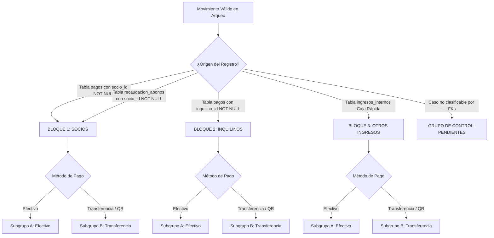

# PLAN DE MEJORA TÉCNICA — ARQUEO DE CAJA DIARIO (VISTA WEB Y REPORTE PDF)
**Sistema ERP — Mercado Cooperativo Primero de Mayo**  
**Fecha:** 15 de Octubre de 2026  
**Documento:** `docs/plans/PLAN_MEJORA_ARQUEO_CAJA.md`  
**Estado:** Propuesta Técnica — Fase de Planificación (Solo Lectura, Esperando Aprobación)

---

## 1. DIAGNÓSTICO DE LA IMPLEMENTACIÓN ACTUAL

El módulo **Arqueo de Caja Diario** (`/reportes/arqueo-diario`) es la herramienta central con la que cajeros, asistentes administrativos, gerencia, contabilidad y el Consejo de Vigilancia cuadran diariamente los ingresos y egresos de la cooperativa.

### 1.1. Estado de los Cálculos Financieros
- **Diagnóstico confirmado:** La lógica matemática y financiera que calcula `total_dia`, `total_efectivo`, `total_transferencia`, `total_gastos`, `saldo_neto` y `efectivo_fisico_caja` **funciona correctamente** y coincide con las verificaciones físicas y bancarias en caja.
- **Premisa obligatoria:** Esta propuesta **NO modifica las fórmulas contables ni los algoritmos de cálculo**. Se concentra exclusivamente en la exclusión de movimientos anulados, la clasificación/agrupación de ingresos por origen y método de pago, la incorporación de subtotales y la reestructuración del reporte PDF.

### 1.2. Problemas Identificados en la Auditoría
1. **Contaminación visual con movimientos anulados:**
   - En la consulta a la tabla `pagos`, no se filtra `deleted_at IS NULL`.
   - En la **vista web**, los pagos anulados aparecen en la tabla con texto tachado y fondo rojizo. Aunque sus importes no se suman a los totales de las tarjetas superiores, ocupan espacio visual y generan dudas en la revisión manual.
   - En el **reporte PDF**, `pdf-generator.service.ts` mapea `r.recibos` directamente sin verificar la propiedad `anulado`. Por ende, los pagos anulados **se imprimen como si fueran cobros normales** (sin tachar y sin advertencia). Sin embargo, el total al pie de la tabla no los incluye, provocando que la suma manual de las filas del PDF difiera del total impreso al pie.
2. **Mezcla indiscriminada de orígenes y métodos:**
   - Actualmente, todos los cobros del día (pagos de socios, pagos de inquilinos, cobros de caja rápida / ingresos internos y abonos de tarjeta) se vuelcan en una sola lista cronológica plana.
   - Para un auditor o miembro del Consejo de Vigilancia resulta muy difícil verificar cuántos soles se cobraron por alquileres de inquilinos en efectivo frente a cuántos soles se cobraron a socios por luz/agua o cuánto se recaudó en baños/parqueo.
3. **Ausencia de subtotales por grupo:**
   - Ni en la web ni en el PDF existen subtotales intermedios que permitan conciliar por separado:
     - Cobranza a Socios (Efectivo vs Transferencia).
     - Cobranza a Inquilinos (Efectivo vs Transferencia).
     - Otros Ingresos espontáneos (Efectivo vs Transferencia).

---

## 2. ARCHIVOS, COMPONENTES Y FUNCIONES INVOLUCRADAS

### 2.1. Rutas Reales en el Código Fuente
1. **Vista y Componente Angular:**
   - [`src/app/pages/reportes/arqueo-caja.component.ts`](file:///c:/Github/SistemaCooperativa/src/app/pages/reportes/arqueo-caja.component.ts)
   - *Responsabilidad:* Renderizado de tarjetas KPI, resumen por método de pago, desglose por concepto, listado de recibos, egresos y ajustes; control de fecha y apertura de caja; invocación de generación de PDF.
2. **Servicio Contable y Consultas Supabase:**
   - [`src/app/core/services/reportes.service.ts`](file:///c:/Github/SistemaCooperativa/src/app/core/services/reportes.service.ts)
   - *Funciones clave:*
     - `cargarArqueo(fecha, soloMiCajero)` (Líneas 250–377): Consultas concurrentes a `pagos`, `ingresos_internos`, `gastos`, `recaudacion_abonos`, `caja_aperturas` y `caja_ajustes`.
     - `construirResumen(...)` (Líneas 380–584): Agregación en memoria de importes, conceptos, cajeros y balance físico/contable.
3. **Motor de Generación de PDF (pdfmake):**
   - [`src/app/core/services/pdf-generator.service.ts`](file:///c:/Github/SistemaCooperativa/src/app/core/services/pdf-generator.service.ts)
   - *Funciones clave:*
     - `generarArqueoYAbrir(resumen, cajero)` (Línea 281).
     - `construirDocumentoArqueo(r, cajero)` (Líneas 293–585): Definición de tablas, estilos, colores y estructura del documento PDF.
4. **Tablas y Relaciones de Base de Datos (Solo Lectura):**
   - `public.pagos`: Cobros formales con recibo (`socio_id`, `inquilino_id`, `puesto_id`, `monto_total`, `metodo_pago`, `deleted_at`).
   - `public.ingresos_internos`: Cobros de Caja Rápida sin recibo formal (`concepto_id`, `monto`, `metodo_pago`, `deleted_at`).
   - `public.recaudacion_abonos`: Abonos semanales en efectivo de tarjeta prepago (`socio_id`, `monto`, `deleted_at`).
   - `public.gastos`: Egresos del día pagados en efectivo (`categoria_gasto_id`, `monto`, `deleted_at`).
   - `public.caja_aperturas` y `public.caja_ajustes`: Saldo inicial y faltantes/sobrantes físicos de gaveta.

---

## 3. HALLAZGOS SOBRE EL TRATAMIENTO DE ANULACIONES

| Fuente de Datos | Tratamiento en Consulta (`cargarArqueo`) | Tratamiento en Web (`arqueo-caja.component.ts`) | Tratamiento en PDF (`pdf-generator.service.ts`) | Diagnóstico |
|---|---|---|---|---|
| **`pagos`** | **NO filtra** `deleted_at IS NULL`. Carga tanto vigentes como anulados. | Se muestran todas las filas; las anuladas se muestran con `line-through` y fondo rojizo. | **ERROR CRÍTICO:** Se imprimen en la tabla como filas normales sin distinción, provocando descuadre visual con el total del pie. | **Debe excluirse al 100% del detalle** tanto en web como en PDF. |
| **`ingresos_internos`** | **Sí filtra** `.is('deleted_at', null)`. | Solo aparecen ingresos vigentes. | Solo aparecen ingresos vigentes. | Correcto. Se mantiene. |
| **`recaudacion_abonos`** | **Sí filtra** `.is('deleted_at', null)`. | Solo aparecen abonos vigentes. | Solo aparecen abonos vigentes. | Correcto. Se mantiene. |
| **`gastos`** | **Sí filtra** `.is('deleted_at', null)`. | Solo aparecen egresos vigentes. | Solo aparecen egresos vigentes. | Correcto. Se mantiene. |

### Decisión de Diseño para Anulaciones:
- En `ReportesService.cargarArqueo`: Se separarán los pagos válidos de los anulados.
- La colección `r.recibos` entregará **única y exclusivamente movimientos válidos** (`deleted_at IS NULL`).
- Si se desea conservar visibilidad informativa para auditoría, se puede mantener un indicador o contador en la cabecera: *"X recibos anulados excluidos de este arqueo (ver en Gestión de Pagos / Auditoría)"*, pero **ninguna fila anulada aparecerá en las tablas detalladas de la web ni en el PDF**.
- Con esto, **la suma aritmética de las filas visibles en cualquier tabla siempre coincidirá al centavo con el subtotal y el total**.

---

## 4. MODELO PROPUESTO PARA AGRUPAR MOVIMIENTOS

### 4.1. Criterio de Clasificación Relacional y Fiable
Para cumplir estrictamente con el **Requerimiento C** y no depender de nombres de texto ni prefijos, la clasificación se basará en las claves foráneas y la entidad de origen:



#### Reglas de Clasificación Rigurosas:
1. **BLOQUE 1 — INGRESOS DE SOCIOS:**
   - Registros de `pagos` donde `p.socio_id IS NOT NULL`.
   - Registros de `recaudacion_abonos` (abonos de tarjeta prepago en efectivo, vinculados obligatoriamente a un `socio_id`).
   - Identificación en listado: Nombre completo del Socio (`s.apellidos, s.nombres`) y código de puesto titular (`puesto.codigo_puesto` o `'—'`).
2. **BLOQUE 2 — INGRESOS DE INQUILINOS:**
   - Registros de `pagos` donde `p.inquilino_id IS NOT NULL`.
   - Identificación en listado: Nombre completo del Inquilino (`i.apellidos, i.nombres`) y código de puesto arrendado o almacén (`puesto.codigo_puesto` o `'—'`).
3. **BLOQUE 3 — OTROS INGRESOS:**
   - Registros de `ingresos_internos` (Caja Rápida: SS.HH. 1er y 2do Piso, Parqueo, Alquiler de espacios temporales, Tickets de eventos/mercado, Donaciones y varios).
   - Identificación en listado: Concepto comercial (`Parqueo`, `SS.HH`, etc.), código `INT-XXXXXX` y observación si existe.
4. **GRUPO DE CONTROL — PENDIENTES DE CLASIFICACIÓN:**
   - Grupo de resguardo que se activará únicamente si existiera un registro válido sin FK a socio, inquilino ni concepto interno, garantizando que **ningún movimiento válido pueda quedar fuera de los totales**.

### 4.2. Estructura de Datos en TypeScript
En `src/app/core/services/reportes.service.ts` se definirá:

```typescript
export type OrigenIngreso = 'SOCIOS' | 'INQUILINOS' | 'OTROS' | 'PENDIENTES';

export interface SubgrupoMetodo {
  metodo: 'Efectivo' | 'Transferencia';
  recibos: ArqueoPago[];
  cantidad: number;
  subtotal: number;
}

export interface BloqueIngresos {
  origen: OrigenIngreso;
  titulo: string;
  subgrupoEfectivo: SubgrupoMetodo;
  subgrupoTransferencia: SubgrupoMetodo;
  totalEfectivo: number;
  totalTransferencia: number;
  totalGeneral: number;
  cantidadTotal: number;
}

export interface ResumenConsolidadoMatriz {
  sociosEfectivo: number;
  sociosTransferencia: number;
  sociosTotal: number;
  
  inquilinosEfectivo: number;
  inquilinosTransferencia: number;
  inquilinosTotal: number;
  
  otrosEfectivo: number;
  otrosTransferencia: number;
  otrosTotal: number;
  
  totalEfectivo: number;
  totalTransferencia: number;
  totalGeneral: number;
}
```

---

## 5. DISEÑO FUNCIONAL DE LA NUEVA INTERFAZ (VISTA WEB)

La vista web mantendrá el diseño visual TailAdmin de Tailwind CSS v4, pero organizará el contenido de manera jerárquica:

### 5.1. Cabecera y Tarjetas Superiores (KPIs Intactos)
- Se conservan las 5 tarjetas superiores:
  1. **Total Recaudado (Ingresos)** (`S/ total_dia`).
  2. **Efectivo en Gaveta** (`S/ efectivo_fisico_caja`).
  3. **Transferencia / QR** (`S/ total_transferencia`).
  4. **Egresos (Salidas)** (`S/ total_gastos`).
  5. **Saldo Neto en Caja** (`S/ saldo_neto`).

### 5.2. Nueva Sección: Cuadro de Resumen Consolidado (Matriz de Origen vs Método)
Ubicada inmediatamente después de las tarjetas KPI, antes de las tablas detalladas:

| Origen | Efectivo | Transferencia / QR | Total General | % Participación |
|---|---:|---:|---:|---:|
| **1. Socios** | `S/ 1,200.00` | `S/ 0.00` | `S/ 1,200.00` | 30.1% |
| **2. Inquilinos** | `S/ 2,117.40` | `S/ 200.00` | `S/ 2,317.40` | 58.2% |
| **3. Otros Ingresos (Caja Rápida)** | `S/ 467.00` | `S/ 0.00` | `S/ 467.00` | 11.7% |
| **TOTAL INGRESOS DEL DÍA** | **`S/ 3,784.40`** | **`S/ 200.00`** | **`S/ 3,984.40`** | **100.0%** |

*Beneficio:* Permite a la Gerencia y Vigilancia auditar en 5 segundos cuánto aportó cada sector comercial y por qué vía bancaria o física.

### 5.3. Detalle de Ingresos en 3 Bloques Visuales Distinguidos

#### BLOQUE 1 — INGRESOS DE SOCIOS (Acento verde suave)
- **Cabecera de bloque:** `border-emerald-200 bg-emerald-50/70 text-emerald-900` con badge identificador y total del bloque a la derecha.
- **Tabla Subgrupo A (Efectivo):**
  - Columnas: `Hora` | `Código` | `Socio` | `Puesto` | `Conceptos` | `Monto` | `Cajero`.
  - Fila final de subtotal: Cantidad de recibos y `Subtotal Efectivo Socios: S/ XXX.XX` (fondo verde claro).
- **Tabla Subgrupo B (Transferencia / QR):**
  - Mismas columnas.
  - Fila final de subtotal: Cantidad de recibos y `Subtotal Transferencias Socios: S/ XXX.XX` (fondo azul claro).
- **Pie de bloque:** Resumen de totales del Bloque Socios (`Efectivo: S/ ...` | `Transferencias: S/ ...` | `Total Socios: S/ ...`).

#### BLOQUE 2 — INGRESOS DE INQUILINOS (Acento azul suave)
- **Cabecera de bloque:** `border-blue-200 bg-blue-50/70 text-blue-900` con badge identificador y total del bloque.
- **Tabla Subgrupo A (Efectivo):** Detalle de recibos de inquilinos en efectivo + Subtotal.
- **Tabla Subgrupo B (Transferencia / QR):** Detalle de recibos de inquilinos en transferencia + Subtotal.
- **Pie de bloque:** Resumen de totales del Bloque Inquilinos.

#### BLOQUE 3 — OTROS INGRESOS (Acento ámbar suave)
- **Cabecera de bloque:** `border-amber-200 bg-amber-50/70 text-amber-900` con badge identificador (`Caja Rápida / Espontáneos`).
- **Tabla Subgrupo A (Efectivo):** Detalle de cobros espontáneos en efectivo (`SS.HH.`, `Parqueo`, etc.) + Subtotal.
- **Tabla Subgrupo B (Transferencia / QR):** Cobros en transferencia + Subtotal.
- **Pie de bloque:** Resumen de totales de Otros Ingresos.

### 5.4. Egresos y Ajustes
- Se mantienen las secciones existentes de **Salidas de Caja (Egresos)** y **Ajustes de Cuadre Físico (Faltantes/Sobrantes)**, colocándolas de forma secuencial y limpia después de los ingresos.

---

## 6. ESTRUCTURA PROPUESTA DEL REPORTE PDF

El documento PDF generado mediante `pdfmake` se rediseñará con un enfoque ejecutivo en dos niveles (Resumen Ejecutivo + Detalle de Auditoría):

```
┌─────────────────────────────────────────────────────────────────────────────┐
│ PÁGINA 1: RESUMEN EJECUTIVO (Para Gerencia, Presidencia y Vigilancia)      │
├─────────────────────────────────────────────────────────────────────────────┤
│ 1. ENCABEZADO INSTITUCIONAL                                                 │
│    Cooperativa Primero de Mayo · Arqueo de Caja Diario                      │
│    Fecha del Arqueo · Cajero / Alcance · Fecha/Hora de Emisión              │
│                                                                             │
│ 2. CUADRO DE RESUMEN CONSOLIDADO (MATRIZ FINANCIERA)                        │
│    ┌──────────────────┬──────────────┬──────────────────┬──────────────┐    │
│    │ Origen           │     Efectivo │ Transferencia/QR │        Total │    │
│    ├──────────────────┼──────────────┼──────────────────┼──────────────┤    │
│    │ Socios           │     S/ --.-- │         S/ --.-- │     S/ --.-- │    │
│    │ Inquilinos       │     S/ --.-- │         S/ --.-- │     S/ --.-- │    │
│    │ Otros Ingresos   │     S/ --.-- │         S/ --.-- │     S/ --.-- │    │
│    ├──────────────────┼──────────────┼──────────────────┼──────────────┤    │
│    │ TOTAL INGRESOS   │     S/ --.-- │         S/ --.-- │     S/ --.-- │    │
│    └──────────────────┴──────────────┴──────────────────┴──────────────┘    │
│                                                                             │
│ 3. CONCILIACIÓN DE CAJA FÍSICA Y SALDO CONTABLE                            │
│    (+) Saldo Inicial (Apertura)        S/ --.--                             │
│    (+) Cobranza Efectivo               S/ --.--                             │
│    (−) Egresos en Efectivo             S/ --.--                             │
│    (−) Faltantes / (+) Sobrantes       S/ --.--                             │
│    ────────────────────────────────────────────                             │
│    (=) EFECTIVO REAL EN GAVETA         S/ --.--                             │
│    (+) Saldo en Banco (Transferencias) S/ --.--                             │
│    ────────────────────────────────────────────                             │
│    (=) SALDO NETO TOTAL CONTABLE       S/ --.--                             │
│                                                                             │
│ 4. DESGLOSE POR CONCEPTO COMERCIAL (Tabla resumida por rubro)               │
│                                                                             │
│ 5. ESPACIO PARA FIRMAS (Cajero Responsable, Administración, Vigilancia)     │
└─────────────────────────────────────────────────────────────────────────────┘
                                  [Salto de Página]
┌─────────────────────────────────────────────────────────────────────────────┐
│ PÁGINAS 2+: DETALLE OPERATIVO (Para Contabilidad, Caja y Auditoría)         │
├─────────────────────────────────────────────────────────────────────────────┤
│ SECCIÓN 2: DETALLE INGRESOS DE SOCIOS                                       │
│   • Subgrupo Efectivo: Tabla (Hora, Código, Socio, Puesto, Concepto, Monto) │
│     Subtotal Efectivo Socios: S/ --.-- (X recibos)                          │
│   • Subgrupo Transferencia/QR: Tabla con mismos campos                      │
│     Subtotal Transferencia Socios: S/ --.-- (X recibos)                     │
│   TOTAL INGRESOS SOCIOS: S/ --.--                                           │
│                                                                             │
│ SECCIÓN 3: DETALLE INGRESOS DE INQUILINOS                                   │
│   • Subgrupo Efectivo: Tabla + Subtotal                                     │
│   • Subgrupo Transferencia/QR: Tabla + Subtotal                             │
│   TOTAL INGRESOS INQUILINOS: S/ --.--                                       │
│                                                                             │
│ SECCIÓN 4: DETALLE OTROS INGRESOS (CAJA RÁPIDA / SIN RECIBO)                │
│   • Subgrupo Efectivo: Tabla + Subtotal                                     │
│   • Subgrupo Transferencia/QR: Tabla + Subtotal                             │
│   TOTAL OTROS INGRESOS: S/ --.--                                            │
│                                                                             │
│ SECCIÓN 5: DETALLE DE EGRESOS (SALIDAS DE CAJA)                             │
│   • Tabla de gastos del día + Total Egresos                                 │
│                                                                             │
│ SECCIÓN 6: AJUSTES FÍSICOS (Si existen faltantes o sobrantes)               │
└─────────────────────────────────────────────────────────────────────────────┘
```

#### Reglas de Maquetación en pdfmake:
- **Repetición de cabeceras:** Propiedad `headerRows: 1` en cada subtabla para que, si un grupo se extiende por varias páginas, los títulos de las columnas se repitan arriba automáticamente.
- **Evitar rotura de filas:** `dontBreakRows: true` en todas las tablas para que una fila de recibo no quede dividida a la mitad entre dos páginas.
- **Paginación profesional:** Pie de página dinámico: `Página X de Y` y fecha/hora exacta de emisión en todas las hojas.
- **Exclusión total de anulaciones:** Cero filas tachadas o anuladas en el PDF; la suma de las filas coincide al 100% con los subtotales.

---

## 7. ESTRATEGIA DE IMPLEMENTACIÓN CON IMPACTO MÍNIMO

1. **Cero cambios en Base de Datos:**
   - No se crearán tablas, columnas, funciones ni políticas RLS. La base de datos ya contiene toda la información requerida (`socio_id`, `inquilino_id`, `deleted_at`, `metodo_pago`).
2. **Transformación pura en capa de servicio (`ReportesService`):**
   - Se modifica `construirResumen()` en `reportes.service.ts` para estructurar los datos agrupados antes de entregarlos al componente y al generador de PDF.
3. **Reutilización de componentes y estilos existentes:**
   - En `arqueo-caja.component.ts` se sustituye el bucle plano por los bloques estructurados usando la misma paleta Tailwind de TailAdmin.
4. **Actualización de `pdf-generator.service.ts`:**
   - Se adapta `construirDocumentoArqueo()` para renderizar la página 1 ejecutiva y los bloques detallados con subtotales.

---

## 8. POSIBLES RIESGOS Y MEDIDAS PREVENTIVAS

| Riesgo Identificado | Causa Potencial | Medida Preventiva Implementada |
|---|---|---|
| **Riesgo 1: Descuadre entre suma de bloques y total del arqueo.** | Error en agrupación o redondeo de decimales. | Se utiliza una función centralizada de verificación: `totalSumaBloques === total_dia`. Si hubiera alguna diferencia, se detecta antes de renderizar. |
| **Riesgo 2: Registro huérfano o no clasificado.** | Un pago sin socio ni inquilino o con datos anómalos. | Incorporación del grupo de control **"Pendientes de clasificación"**, asegurando que ningún sol se pierda de los totales. |
| **Riesgo 3: Desborde o mala paginación en el PDF.** | Días con más de 100 recibos (como fin de mes). | Uso estricto de `headerRows: 1`, `dontBreakRows: true` y márgenes calibrados a 35pt para optimizar espacio sin cortes defectuosos. |
| **Riesgo 4: Confusión entre caja física y transferencias.** | El operador podría pensar que las transferencias están en gaveta. | En la matriz y en las tarjetas se separa explícitamente: *Efectivo (Gaveta)* vs *Transferencia/QR (No entra a gaveta)*. |

---

## 9. MATRIZ DE PRUEBAS Y CRITERIOS DE ACEPTACIÓN

### Escenarios de Prueba Obligatorios:
1. **Día mixto (Socios + Inquilinos + Otros + Efectivo + Transferencias):**
   - Fecha de referencia: `2026-10-14` (22 pagos, 3 ingresos internos).
   - Verificar que los pagos de socios vayan al Bloque 1, los de inquilinos al Bloque 2, y los de baños/parqueo al Bloque 3.
2. **Día con recibos anulados:**
   - Fecha de referencia: `2026-08-25` o `2026-10-13` (fechas con registros anulados en `pagos`).
   - Verificar que los recibos anulados **NO aparezcan** ni en la web ni en el PDF, y que los subtotales coincidan exactamente con la suma de las filas visibles.
3. **Día con egresos y ajustes físicos:**
   - Verificar que los egresos resten del saldo contable y de la gaveta física, y que los ajustes de faltantes/sobrantes se reflejen en el efectivo real.
4. **Día sin movimientos (cero cobros):**
   - Verificar que la matriz muestre ceros limpios y un mensaje amigable sin errores en consola.
5. **Día masivo con múltiples páginas de PDF:**
   - Fecha de referencia: `2026-09-30` (110 recibos emitidos).
   - Verificar que el PDF divida las páginas limpiamente, repita las cabeceras de tabla y mantenga la numeración de páginas correcta.

### Criterios de Aceptación:
- [ ] La suma de `Socios + Inquilinos + Otros = Total Recaudado`.
- [ ] La suma de `Efectivo + Transferencias = Total Recaudado`.
- [ ] Los movimientos anulados están totalmente ausentes del detalle web y del PDF.
- [ ] La primera página o sección del PDF muestra el resumen ejecutivo consolidado.
- [ ] Los totales del PDF coinciden al 100% con los de la vista web.

---

## 10. FASES DE IMPLEMENTACIÓN RECOMENDADAS

Una vez aprobado este plan:

- **Fase 1: Tipado y Agrupación en Servicio Angular (`ReportesService`):**
  - Actualizar interfaces `ArqueoResumen`, `BloqueIngresos` y `ResumenConsolidadoMatriz`.
  - Implementar en `construirResumen()` la separación limpia de anulados y la clasificación relacional en los 3 bloques con sus subtotales.
- **Fase 2: Rediseño de la Vista Web (`ArqueoCajaComponent`):**
  - Implementar la matriz de resumen consolidado.
  - Implementar los 3 bloques visuales con encabezados suaves, subtotales por método y totales por grupo.
- **Fase 3: Rediseño del Reporte PDF (`PdfGeneratorService`):**
  - Implementar la carátula/sección ejecutiva compacta en la página 1.
  - Implementar las secciones detalladas con cabeceras repetidas y subtotales por grupo.
- **Fase 4: Verificación Integral y Pruebas de No-Regresión:**
  - Probar con fechas reales (`2026-10-14`, `2026-09-30`, fechas con anulados).
  - Validar compilación de producción (`npx ng build`).

---

## 11. PREGUNTAS Y DECISIONES CONFIRMADAS

1. **Ubicación de Recaudación Tarjeta (Abonos semanales en efectivo de tarjeta prepago):**
   - *Confirmación:* Dado que `recaudacion_abonos` tiene `socio_id NOT NULL` y representa abonos en efectivo realizados por socios, se integran de forma natural en el **Bloque 1: Ingresos de Socios (Subgrupo Efectivo)** con código identificador `REC-XXXXXX`.
2. **Tratamiento de `ingresos_internos` (Caja Rápida):**
   - *Confirmación:* Todos los cobros de Caja Rápida sin recibo (Parqueo, SS.HH., Tickets, Espacios temporales) se agrupan unificadamente en el **Bloque 3: Otros Ingresos**, resolviendo la confusión de ver conceptos como "Parqueo" etiquetados como "Para Inquilinos".
3. **Preservación de Anulaciones para Auditoría:**
   - *Confirmación:* La exclusión visual del Arqueo Diario no afecta en nada a los módulos de Auditoría, Gestión de Ingresos o Historial de Pagos, donde permanecen 100% intactos con su trazabilidad de usuario y motivo.
